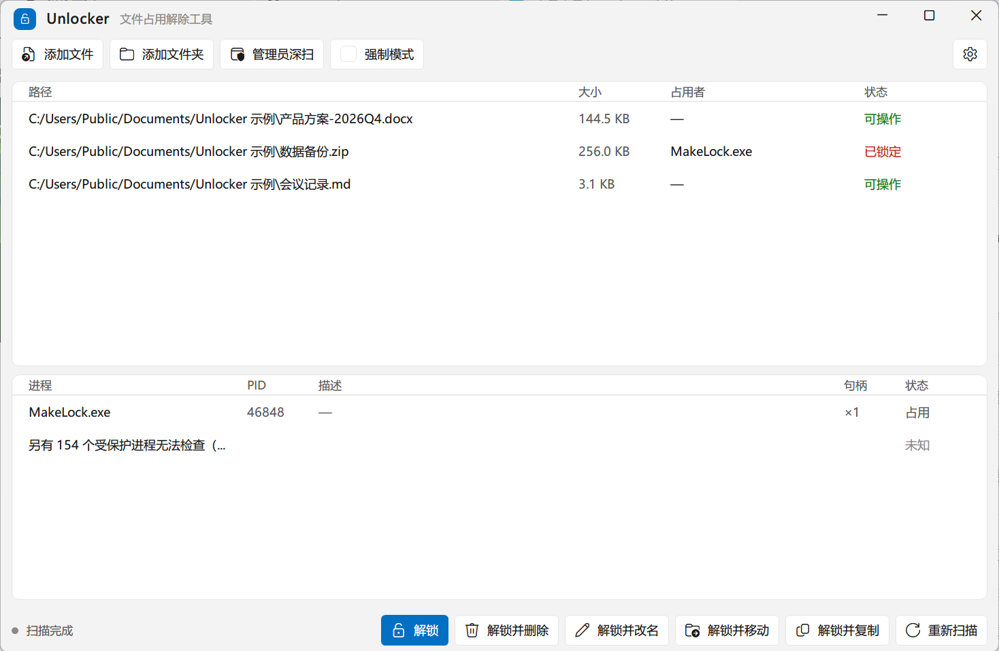
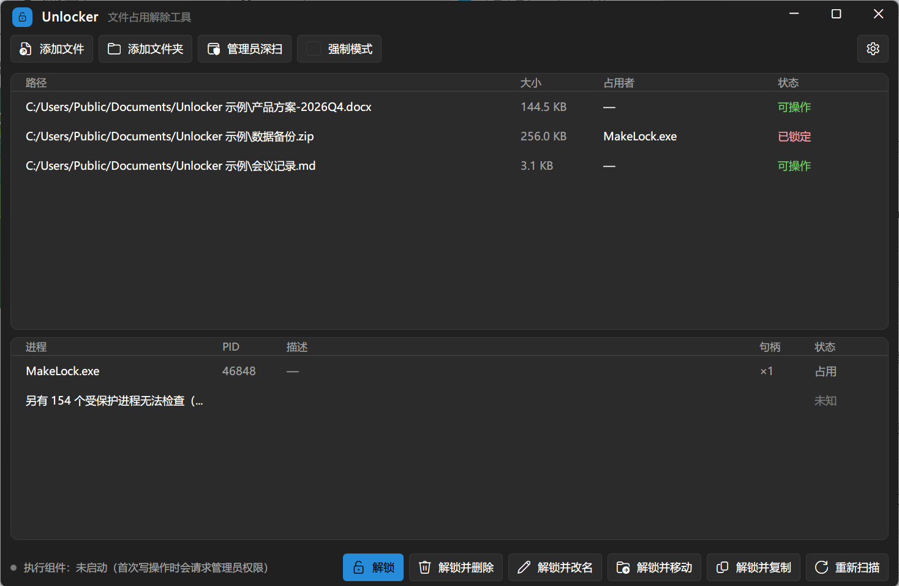
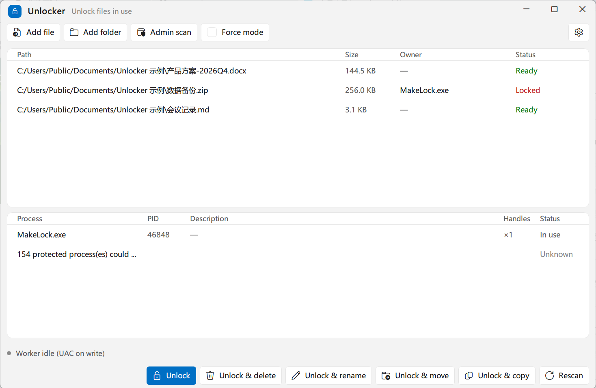
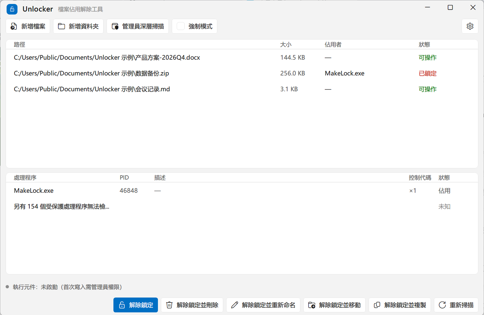
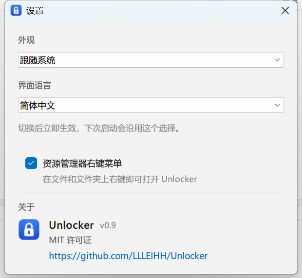
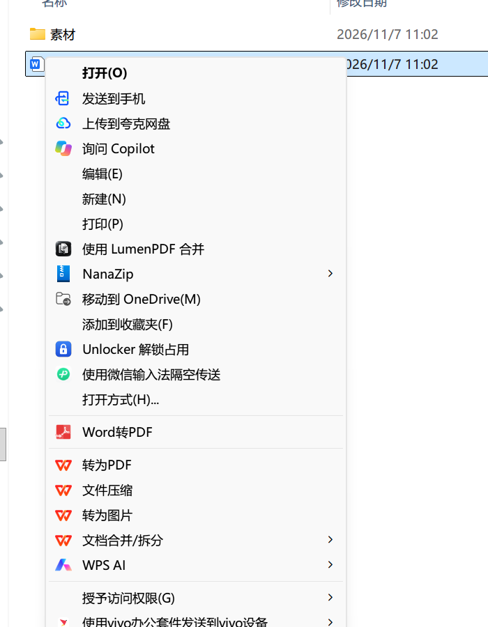

# Unlocker

**Windows 文件占用解锁工具** —— 删不掉的文件夹、改不了名的文件、移动时提示"正被使用"？先看清楚是谁占着，再决定怎么解开。

纯用户态实现，**不加载内核驱动**；权限按「动作」分配，而不是整个窗口一直以管理员身份运行。

**受IObit Unlocker启发，使用DeepSeek V4.1 FLASH和GLM5.3完成，可能是狗*代码，除了想法和这句话，都是AI完成**

[](https://github.com/LLLEIHH/Unlocker/actions/workflows/build.yml)
[](LICENSE)




<details>
<summary>深色模式 / 英文 / 繁体中文</summary>







</details>

<details>
<summary>设置窗口 / 右键菜单</summary>





</details>

## 下载

到 [Releases](../../releases/latest) 下载 **`Unlocker-Single.exe`**（约 730 KB），双击即用：

- **单文件**：静态链接 CRT，只依赖系统 DLL，不需要 VC++ 运行库
- **不需要安装**：拷到任何 Windows 10 / 11 x64 机器上都能直接跑，不写 `%LOCALAPPDATA%`
- **卸载**：删掉 exe 即可。注册表只动 `HKCU\Software\Unlocker`（语言 / 外观 / 右键菜单开关 / 窗口位置）
- 想保留右键菜单就别频繁挪 exe；挪过之后运行一次会自动修正注册表里的路径

## 能做什么

| 能力 | 说明 |
| --- | --- |
| 找占用者 | 枚举系统句柄，直接告诉你是**哪个进程**、握着**几个句柄**、能不能安全释放 |
| 8 种占用状态 | 可操作 / 已打开 / 已锁定 / 映像占用 / 权限不足 / 驱动锁定 / 不存在 / 无法访问 —— 状态不同，处理方式不同 |
| 分级解锁 | L0 直接删 → L1 关句柄 → L2 结束进程 → L4 重启后删除，能低级别解决就绝不动用高级别 |
| 安全操作 | 解锁后删除 / 改名 / 移动 / 复制，支持批量与递归目录 |
| 黑名单兜底 | 系统关键路径、页面文件、注册表配置单元等**内置规则表**直接拒绝，`--force` 也绕不过 |
| 多语言 | 简体中文 / 繁体（台湾、香港、澳门）/ 英文，按各地用语区分；系统是中文（含港澳台）默认简中，否则英文，设置里随时切换 |
| 深浅色 | 跟随系统 / 浅色 / 深色三档，立即生效并记住选择 |
| 右键菜单 | 右键文件、文件夹或文件夹空白处出现「Unlocker 解锁占用」，直达界面并自动扫描 |
| 深扫 | 普通权限看不到服务与受保护进程的占用，需要时再单独提权扫一遍 |

## 安全模型（先说清楚，别踩坑）

- **不加载驱动**：全部通过公开 Win32/NTAPI 完成，所以做不到"解锁一切"，比如被文件系统过滤驱动锁住的情况只能如实告诉你
- **最小权限**：GUI 以普通权限启动（拖放和右键菜单才正常），只有真正写盘或深扫时才弹 UAC 拉起一个 worker
- **黑名单不可关闭**：规则表带 CRC 自检，校验不过就直接进入 fail-closed（全表拒绝），宁可不干活也不误删
- **单文件版不含自解压**：静态 CRT 链接，exe 原地运行，不会把任何文件释放到用户可写目录；提权 worker 与 UI 是同一个 exe 的两个身份（`--worker`），靠命名管道 + 三重身份校验通信

## 交付形态

| 形态 | 产物 | 说明 |
| --- | --- | --- |
| **单文件版（默认交付）** | `Unlocker-Single.exe`（约 730 KB） | Win32 前端 + 静态 CRT，单 exe，不需要运行库、不需要解压 |
| 常规构建 | `Unlocker.exe`（约 500 KB） | 动态链接 CRT，体积更小，机器上需有 VC++ 运行库 |
| 可选组件 | `UnlockerShell.dll` | 早期 COM 右键扩展；右键菜单已改为注册表 verb，**这个 DLL 不再需要**，仅为清理旧安装保留 |

## 从源码构建

需要 **VS 2022**（Community 或 BuildTools，含 C++ 工作负载）、**CMake ≥ 3.20**、**Windows SDK 10.0.26100**、Python 3。

```bat
build.cmd            :: 常规构建（动态 CRT）+ 单元测试，产物在 build\Release\
build.cmd single     :: 单文件版（静态 CRT），产物在 build-single\Release\
```

跑测试：

```bat
cd build && ctest -C Release        :: 三套一起跑

build\Release\policy_tests.exe     :: 黑名单裁决、分级、三次确认
build\Release\ipc_tests.exe        :: 管道协议、身份校验、超长帧
build\Release\subtree_tests.exe    :: 目录子树占用、解锁后改名
```

## 目录结构

```
src/core/      句柄扫描、占用判定、分级拆锁、文件操作、黑名单裁决（无 UI 无 IPC 依赖）
src/common/    字符串 / 路径 / 日志 / 错误映射；多语言表（Lang.h + LangTable.cpp）
src/ipc/       命名管道 + 提权 worker（三重身份校验）
src/ui/        Win32 前端：Theme 层、自绘控件、主窗口、设置窗口
src/shell/     右键菜单注册（HKCU 注册表 verb）+ 旧 COM 扩展
src/cli/       命令行入口（--list / /u / /d / /r / /m / /c）
tools/         规则表 CRC、图标生成、语言表生成、产物校验、开发期截图脚本
tests/         policy / ipc / subtree 三套回归
docs/          截图
notes/         内部施工笔记（不入库）
```

## 贡献

欢迎提 Issue 和 PR，先看 [CONTRIBUTING.md](CONTRIBUTING.md)。安全问题请走 [SECURITY.md](SECURITY.md)，不要开公开 issue。

## 许可

[MIT](LICENSE)。这是个会删文件的工具，请先在虚拟机或测试目录里试用。

---

# 实现细节

> 以下是施工过程中留下的记录，面向要改代码的人。设计取舍、踩过的坑、为什么这么写都记在这里。
> （早期那几份执行方案与评审记录属于内部笔记，没有随仓库发布。）

## 一、已经能跑的部分

| 能力 | 状态 | 实现位置 |
|---|---|---|
| 句柄枚举 / 占用者定位（F1） | 完成 | `src/core/HandleScanner.cpp` |
| 8 种占用状态判定 + 进程身份补全（F19） | 完成 | 同上（版本资源含 `080404B0` 语言块回退） |
| 路径归一化 / CanonicalPath / junction 解引用（4.3 / 4.6.4） | 完成 | `src/core/PathResolver.cpp` |
| 内置黑名单三级裁决 + FILE_ID 双表 + CRC fail-closed（F15） | 完成 | `src/core/PolicyGuard.cpp` + `rules/Blacklist.def` |
| 分级拆锁 L0/L1/L2/L4/L5（F2/F7/F12） | 完成 | `src/core/LockBreaker.cpp` |
| 删除/改名/移动/复制，递归删除与黑名单交互（F3-F6/F11） | 完成 | `src/core/FileOps.cpp` |
| 重启兜底（F8） | 完成 | `src/core/RebootScheduler.cpp` |
| 提权 worker + 命名管道 + 三重身份校验 + 重校验 + 空闲退出（F18/F20） | 完成 | `src/ipc/*` |
| GUI：拖入 / 选择器 / 两级列表 / 深浅扫 / 提权自查（F16/F17/F20） | 完成 | `src/ui/*` |
| 自绘界面：标题栏 / 按钮 / 卡片列表 / 深浅色 / 高 DPI | 完成 | `src/ui/Theme.cpp` + `MainWindow.cpp` |
| 多语言（5 种，按地区用语区分） | 完成 | `src/common/LangTable.cpp`（由 `tools/gen_lang.py` 生成） |
| 右键菜单（F9） | 完成（注册表 verb，无需管理员/DLL） | `src/shell/ShellIntegration.cpp` |
| CLI（F10，退出码 0-8） | 完成 | `src/cli/CliMain.cpp` |
| 造锁工具 | 完成 | `tools/MakeLock` |
| Level 3（卸 DLL 映像） | 未实现（P2，方案里也是可选） | — |

## 二、构建

需要 MSVC 2022（本机为 **VS 2022 Community 17.14**，`C:\Program Files\Microsoft Visual Studio\2022\Community`，
MSVC 14.44 + SDK 10.0.26100；`build.cmd` 会按 BuildTools → Community → vswhere 三级探测）与 CMake ≥ 3.20。

```bat
build.cmd
```

或手动：

```bat
cmake -S . -B build -G "Visual Studio 17 2022" -A x64 -DPython3_EXECUTABLE=<python.exe>
cmake --build build --config Release
```

产物在 `build\Release\`：`Unlocker.exe`、`UnlockerShell.dll`、`MakeLock.exe`、`policy_tests.exe`、`ipc_tests.exe`、`subtree_tests.exe`。
单文件版用 `build.cmd single`，产物在 `build-single\Release\Unlocker.exe`。

**本机踩到的坑（必须知道）**：环境里同时存在 `HTTP_PROXY` 与 `http_proxy`（大小写重复键）时，
MSBuild 的 ClCompile 任务会抛 `MSB6001 ... 关键字 HTTPS_PROXY / https_proxy`，表现为
“No CMAKE_CXX_COMPILER could be found”。构建前清掉一组代理变量即可（`build.cmd` 已处理）。

规则表 CRC 由 `tools/gen_rules_crc.py` 在构建期从 `Blacklist.def` 生成到
`build\generated\BlacklistCrc.h`，运行期重算并比对；不匹配即 **fail-closed（全表 Deny）**。

## 三、使用

### GUI

直接双击 `Unlocker.exe`（`asInvoker`，**不弹 UAC**）。拖文件/文件夹进窗口，或点「添加文件 / 添加文件夹」。
拖入即跑 **L1 免提权扫描**；只有「深扫」和任何写操作才提权。

> manifest 里的 `asInvoker` 是功能依赖：改成 `requireAdministrator` 会让拖放在 Win10/11 上
> 静默失效（收不到 `WM_DROPFILES`），不报错、不崩溃。

### CLI

```
Unlocker.exe --list <路径...>            只读，免提权，遇到打不开的进程标注「需要管理员深扫」
Unlocker.exe --list --json <路径...>     机器可读
Unlocker.exe /u  <路径...>               仅解锁（关句柄）
Unlocker.exe /d  <路径...>               解锁并删除
Unlocker.exe /r 新名 <路径>              解锁并改名
Unlocker.exe /m 目标目录 <路径...>       解锁并移动
Unlocker.exe /c 目标目录 <路径...>       解锁并复制
              --force                    允许杀进程（**不等于**无视黑名单）
              --reboot                   失败时排队到重启
              --quiet                    禁止任何 UAC（需要提权时退出码 8）
```

退出码：`0` 成功 / `1` 参数错误 / `2` 未找到占用者 / `3` 权限不足 / `4` 黑名单拦截 /
`5` 解锁失败 / `6` 需要重启 / `7` 需要确认但 quiet / `8` 需要提权但 quiet。

### 右键菜单

首次启动会问一次要不要添加，之后在「设置 → 资源管理器右键菜单」里随时开关。

```
Unlocker.exe --install      添加（当前用户，无需管理员）
Unlocker.exe --uninstall    移除（顺带清掉旧版 COM 扩展的残留）
```

实现是 HKCU 下的三个注册表 verb（`*` / `Directory` / `Directory\Background`），
不加载 DLL、不需要管理员，单文件版也能用；菜单文字随界面语言在安装时写入。
Win11 新菜单里只会在「显示更多选项」中出现；不放 MSIX 包这是必然行为，不是 bug。

## 四、安全设计落点（与方案逐条对应）

- **UI 中完整性 + 提权 worker**：`main.cpp` 三态分流；`--worker` 无 `--pipe` 直接退出（退出码 2）。
- **管道**：`D:(A;;GA;;;UI_SID)(A;;GA;;;自身SID)S:(ML;;NW;;;ME)`。
  SACL 是功能必需（否则中完整性 UI 连不上高完整性 worker，报 `ACCESS_DENIED` 极易查错方向）；
  DACL 同时放行 UI 侧 SID（跨用户提权场景）。
- **客户端三重校验**：PID == `--parent-pid`、映像路径 == 本 exe、客户端创建时间早于 worker。
- **worker 端重校验**：路径重新归一化 + 重新裁决 + 规则表 CRC 自检，UI 传来的路径一律不可信。
- **Confirm 只由 worker 弹框**：UI 只标注「需确认」，不收集决定；`--quiet` 下返回 `code=7`。
- **op 白名单**：`hello/ping/scan/unlock/delete/rename/move/copy/reboot/cancel/shutdown`，
  没有任何 `exec/shell/run` 入口；未知 op 直接拒绝并断连。
- **单帧 ≤ 16MB**，超长长度头直接断连。
- **递归删除**：先遍历预检、再统一执行；目录 Deny 整棵跳过、子项 Deny 跳过并汇总。
- **自我排除**：扫描过滤自身与父进程，避免「Unlocker 被 Unlocker 占用」。

## 五、测试

```
build\Release\policy_tests.exe    26 项全绿（T17-T24 + PREFIX 边界 + COUNT + 三段式提示）
build\Release\ipc_tests.exe       10 项全绿（SACL 建管道 / hello / ping / scan / 重校验 / 畸形帧 / 版本错位）
build\Release\subtree_tests.exe    3 项全绿（子树占用扫描 / 原始 MoveFile 必失败 / FileOps::Rename 成功）
```

手工验证过：

```
MakeLock.exe <file> 45                    # 造锁
Unlocker.exe --list <file>                # -> 已锁定 + MakeLock.exe (PID)
MakeLock.exe <file> --sharedelete 25      # 可删占用
Unlocker.exe --list <file>                # -> 已打开（不是「锁定」）
Unlocker.exe --list C:\Windows\System32\ntoskrnl.exe   # -> [内置黑名单] BL-003
Unlocker.exe --worker                     # -> 退出码 2，无任何行为
```

**仍需在真机上人工点一遍**（自动化无法批准 UAC）：T32（取消 UAC）、T33（会话复用只弹一次）、
T34（空闲 5 分钟自退）、T48（手动提权后拖放仍有横幅提示）、T52（标准用户输入管理员凭据跨用户提权）。

## 六、已知限制

1. **进程列表右键「结束进程」菜单未做**：协议 op 表是白名单，没有 `kill` 项；终止进程目前只能通过
   「强制模式 + 解锁并删除」这条路径走 `Level 4`，并且会先过黑名单与二次确认。
   要补这个菜单，得先给协议加一个 `kill(pid)` 并在 worker 端做同样的裁决，不是纯 UI 改动。
2. **未产出 x86 版本**：x64 单文件版已覆盖 Win10/11 x64，32 位系统不在支持范围。
   （只有旧的 COM 扩展 `UnlockerShell.dll` 才需要 32/64 各一份；右键菜单改走注册表 verb 后已无此约束。）
3. **Level 3（卸映像）未实现**，映像占用会如实提示「只能结束进程或重启后删除」。
4. `HICON` 不参与 IPC（`ProcessInfo` 过不了管道），UI 侧要靠 `fullPath` 自己取图标；当前列表用文字状态，
   图标未接入。
5. 黑名单规则表 CRC 只能防「改了规则忘了改 CRC」这类手滑，**不是防破解**；真正的完整性只能靠代码签名。

## 七、版本控制

仓库用 git 管理（`main` 分支）。几个约定，改 `.gitignore` 之前先看一眼：

| 规则 | 原因 |
| --- | --- |
| 忽略 `/build/`、`/build-single/` | 构建产物，随时可再生 |
| 忽略 `/.workbuddy/` | 开发期记忆与会话数据，不属于源码 |

`.gitattributes` 里 **`*.cmd` / `*.bat` 强制 `eol=crlf`**：LF 的批处理在 cmd.exe 下会解析出错
（`chcp 65001` 时还会吃中文字节）。仓库内统一存 LF，工作区按规则还原成 CRLF。

## 八、应用图标

图标不是手绘的位图，而是**几何定义 → 一次生成全部尺寸**：

```
assets/icons/unlock-a4.svg     # 设计稿（矢量，可编辑）
assets/icons/unlocker.ico      # 成品：16/24/32/48/64/128/256 七档
tools/make_icon.py             # 生成器（纯 Python，无 Pillow/ImageMagick 依赖）
```

改图形只需要改 `tools/make_icon.py` 里的 `VARIANTS` 几何常量，然后：

```bat
python tools\make_icon.py --variant a4 --ico assets\icons\unlocker.ico --svg assets\icons\unlock-a4.svg
python tools\make_icon.py --sheet preview.png        :: 三方案对照图
```

设计空间固定 256×256：圆角方块 8..248（r=56）、锁体 72..184 × 114..206、
锁梁弧心与锁体主轴都在 x=128（早期版本锁梁整体偏右 14 单位，看起来是歪的，已修）。

exe 通过资源脚本引用它：

| 资源脚本 | 说明 |
| --- | --- |
| `src/ui/Resource.rc` | 图标 + 版本信息；ico 路径由 `CMakeLists.txt` 的 `include_directories` 提供 |

资源 ID 用数字 `101`（`#define IDI_APPICON 101`），不用字符串名 —— 字符串名虽然也能编译，
但 shell 取图标是按序号落的，用名字容易出现「资源在、任务栏却没图标」。

校验方式（不依赖任何额外工具）：`FindResourceW(exe, 101, RT_GROUP_ICON)` 非空，
或 `ExtractIconExW` 取第 0 个图标能画出来。

## 九、单文件版（Unlocker-Single.exe）

当前交付的单文件版是 **Win32 前端 + 静态 CRT**：

```bat
build.cmd single
```

CMake 用 `UNLOCKER_STATIC_CRT=ON` 在**任何 target 之前**把 `CMAKE_MSVC_RUNTIME_LIBRARY` 设成
`MultiThreaded`，保证 `unlocker_core` 静态库与 exe 用同一套运行库 —— 混用会 LNK2038 直接失败，
硬链过去则会在运行时出现两份 CRT 状态。

| 项 | 说明 |
| --- | --- |
| 体积 | 约 730 KB（比动态 CRT 版多约 200 KB） |
| 依赖 | 只有系统 DLL：gdiplus / dwmapi / uxtheme / user32 / gdi32 / comctl32 / shell32 / ole32 / version / bcrypt / advapi32 / kernel32 |
| 部署 | 单个 exe，不解压、不写 `%LOCALAPPDATA%`、不需要管理员 |
| 右键菜单 | 可用：装的是 HKCU 注册表 verb，不需要附带 DLL |
| 命令行 | 完整保留：`--list` / `/u` / `/d` / `/r` / `/m` / `/c` / `--worker` 全在这一个文件里 |
